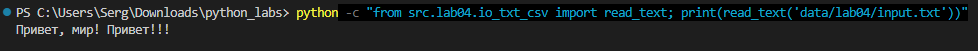
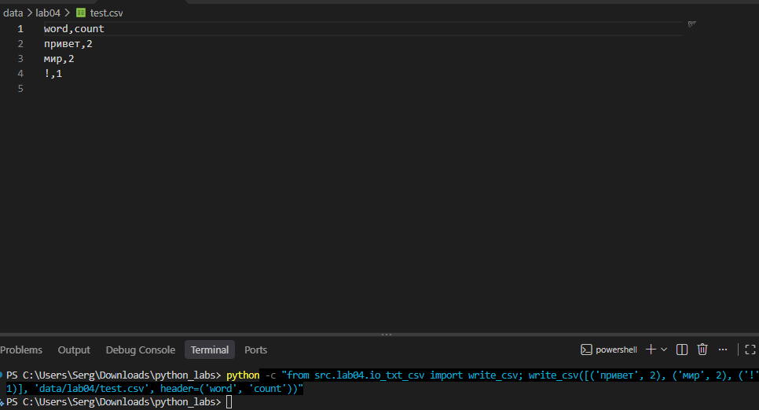
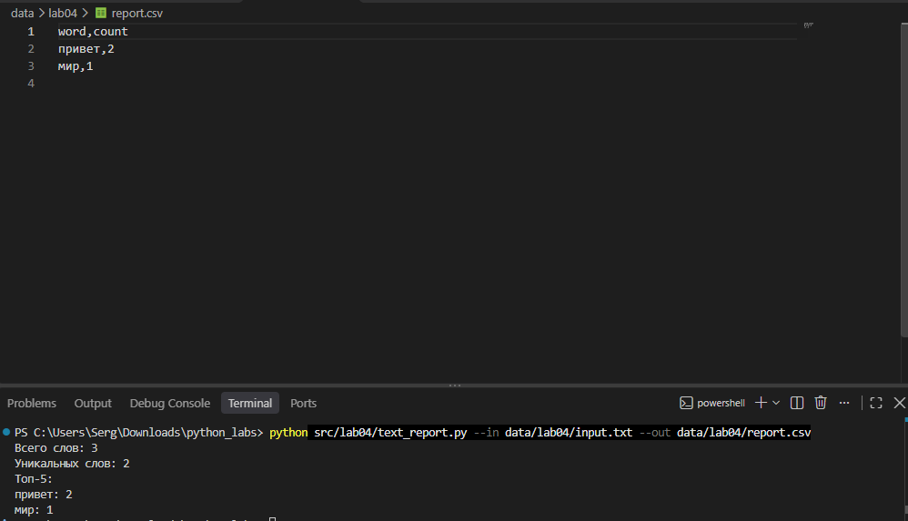
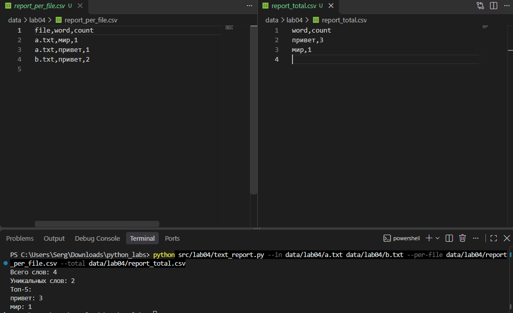

# Лабораторная работа 4

## Задание 1 — Чтение текстовых файлов

Реализована функция `read_text()`, которая считывает содержимое файла и возвращает его в виде строки. По умолчанию используется кодировка UTF-8, при необходимости можно указать другую кодировку, например CP1251. При отсутствии файла или ошибке декодирования возникает соответствующее исключение. Пустой файл возвращает пустую строку.

[Код: src/lab04/io_txt_csv.py](../../src/lab04/io_txt_csv.py)

## Задание 2 — Запись данных в CSV

Реализована функция `write_csv()`, которая записывает данные в CSV-файл с разделителем-запятой и кодировкой UTF-8. При необходимости добавляет строку заголовков и проверяет, что все строки содержат одинаковое количество элементов. Для создания родительских директорий предусмотрена функция `ensure_parent_dir()`.

[Код: src/lab04/io_txt_csv.py](../../src/lab04/io_txt_csv.py)

## Задание 3 — Формирование отчёта по тексту

Скрипт `text_report.py` считывает текст из входного файла, нормализует его, разбивает на слова и подсчитывает частоту каждого слова с использованием функций из лабораторной работы 3. Результат сохраняется в `report.csv` с колонками `word,count`. Слова сортируются по убыванию частоты, а при одинаковой частоте — в алфавитном порядке.

[Код: src/lab04/text_report.py](../../src/lab04/text_report.py)

## Задание 4 — Вывод статистики в консоль

После обработки файла программа выводит общее количество слов, количество уникальных слов и топ-5 самых частых слов с указанием их частоты. Для выбора входного файла, выходного отчёта и кодировки предусмотрены параметры командной строки. При пустом входном файле CSV содержит только заголовок `word,count`, а статистика показывает нулевые значения.

[Код: src/lab04/text_report.py](../../src/lab04/text_report.py)

## Задание 5 — Обработка нескольких файлов ★

Реализована обработка нескольких входных файлов с подсчётом частот слов отдельно для каждого файла и для всех файлов вместе. Формируются два CSV-отчёта: `report_per_file.csv` с колонками `file,word,count` и `report_total.csv` с колонками `word,count`. Результаты сортируются по имени файла, убыванию частоты и алфавиту в соответствии с требованиями задания.

[Код: src/lab04/text_report.py](../../src/lab04/text_report.py)

