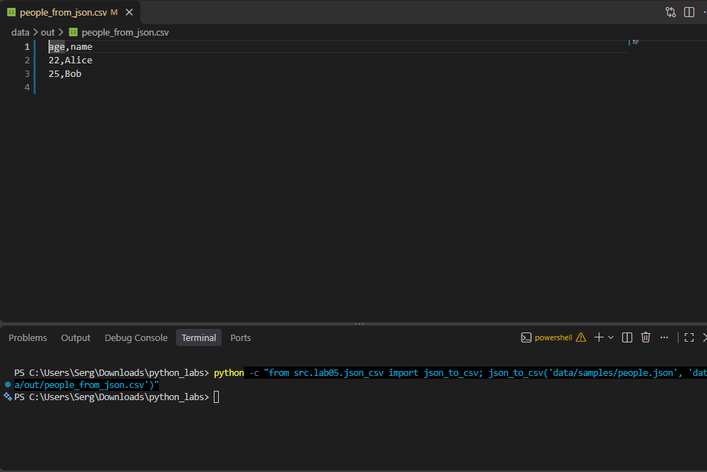
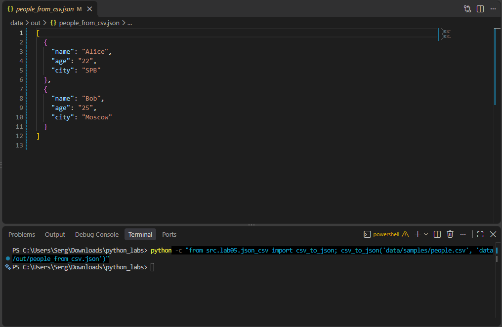
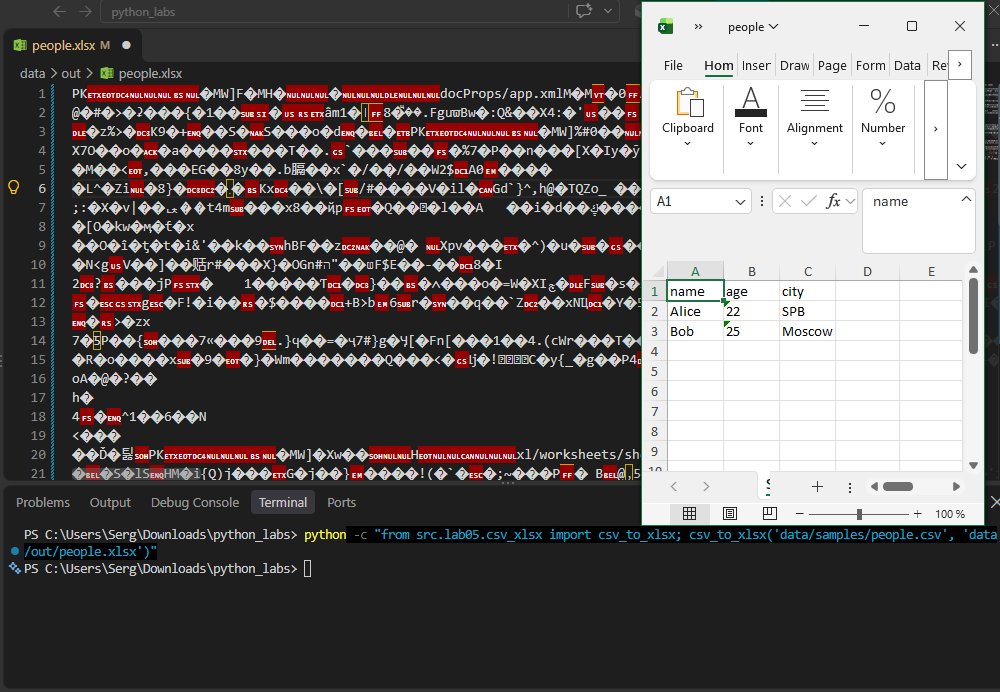

# Лабораторная работа 5

## Задание 1 — Преобразование JSON в CSV

Реализована функция `json_to_csv()`, которая считывает список словарей из JSON-файла и записывает данные в CSV. Названия столбцов формируются по ключам объектов и сортируются в алфавитном порядке. Если в каком-либо объекте отсутствует ключ, соответствующая ячейка остаётся пустой. Для чтения и записи используется кодировка UTF-8.

Входной файл: `data/samples/people.json`.

[Код: src/lab05/json_csv.py](../../src/lab05/json_csv.py)

## Задание 2 — Преобразование CSV в JSON

Реализована функция `csv_to_json()`, которая считывает CSV-файл с заголовками и преобразует его строки в список словарей JSON. Заголовки используются в качестве ключей объектов, а значения сохраняются в виде строк. Результат записывается в JSON с отступами для удобного чтения и сохранением кириллицы.

Входной файл: `data/samples/people.csv`

[Код: src/lab05/json_csv.py](../../src/lab05/json_csv.py)

## Задание 3 — Преобразование CSV в XLSX

Реализована функция `csv_to_xlsx()`, которая переносит данные из CSV-файла в электронную таблицу Excel. Первая строка используется в качестве заголовка, а лист получает название `Sheet1`. Ширина столбцов автоматически подбирается по содержимому и составляет не менее 8 символов. Для создания XLSX-файла используется библиотека `openpyxl`.

Входной файл: `data/samples/people.csv`.

[Код: src/lab05/csv_xlsx.py](../../src/lab05/csv_xlsx.py)

## Проверка входных данных

В программах предусмотрена проверка расширений файлов, наличия входных файлов, структуры JSON и корректности CSV. При обнаружении ошибок выбрасываются соответствующие исключения. Если выходная директория отсутствует, она создаётся автоматически.

## Вывод

В ходе лабораторной работы были реализованы преобразования данных между форматами JSON, CSV и XLSX. Были закреплены навыки чтения и записи файлов, обработки табличных данных, проверки входных данных и работы с библиотекой `openpyxl`.
