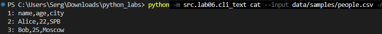
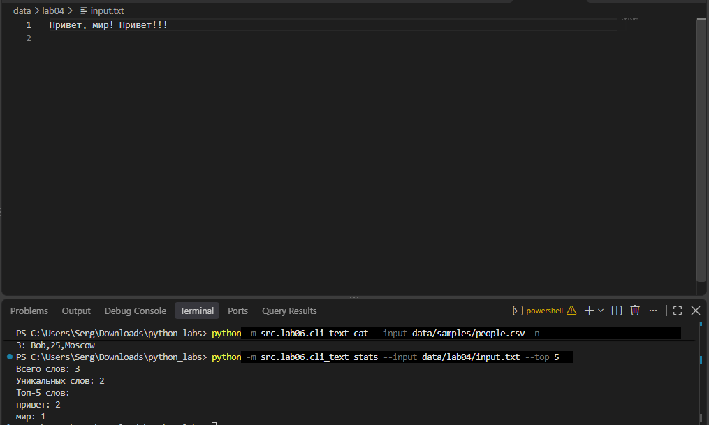
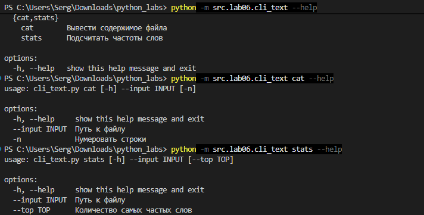

# Лабораторная работа 6

## Задание 1 — Вывод содержимого файла (cat)

Реализована CLI-команда `cat`, которая считывает содержимое указанного файла и выводит его в консоль построчно. Для указания файла используется параметр `--input`. Дополнительный параметр `-n` включает нумерацию строк.

[Код: src/lab06/cli_text.py](../../src/lab06/cli_text.py)

## Задание 2 — Подсчёт статистики текста (stats)

Реализована CLI-команда `stats`, которая анализирует текстовый файл и выводит статистику по словам. Для обработки используются функции из лабораторной работы 3. Программа показывает общее количество слов, количество уникальных слов и список наиболее часто встречающихся слов. Параметр `--top` позволяет задать количество слов в итоговом списке. По умолчанию выводится топ-5.

[Код: src/lab06/cli_text.py](../../src/lab06/cli_text.py)

## Задание 3 — Справка для текстовых команд

Для CLI-утилиты `cli_text.py` реализована справочная информация с помощью библиотеки `argparse`. Команда `--help` выводит список доступных подкоманд и их описание. 

[Код: src/lab06/cli_text.py](../../src/lab06/cli_text.py)

## Задание 4 — Конвертация файлов

Реализована CLI-утилита `cli_convert.py`, объединяющая три команды для преобразования файлов: `json2csv` — JSON в CSV, `csv2json` — CSV в JSON, `csv2xlsx` — CSV в XLSX. Для выполнения преобразований используются функции из лабы 5. Входной и выходной файлы задаются параметрами `--in` и `--out`.

[Код: src/lab06/cli_convert.py](../../src/lab06/cli_convert.py)

## Задание 5 — Справка для команд конвертации

Для утилиты `cli_convert.py` реализована справочная информация. С помощью параметра `--help` можно посмотреть доступные команды конвертации, а также узнать назначение параметров каждой команды.

[Код: src/lab06/cli_convert.py](../../src/lab06/cli_convert.py)

