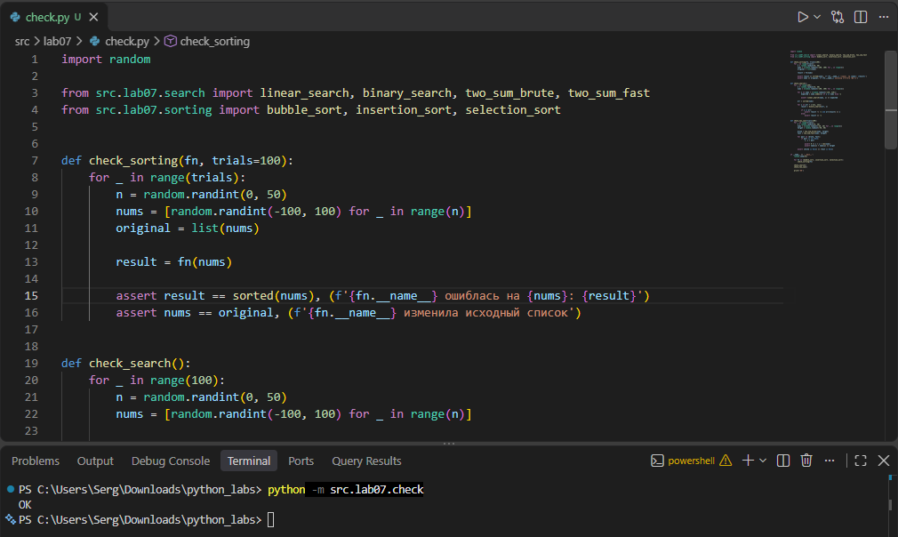
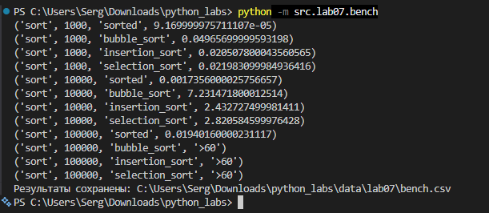
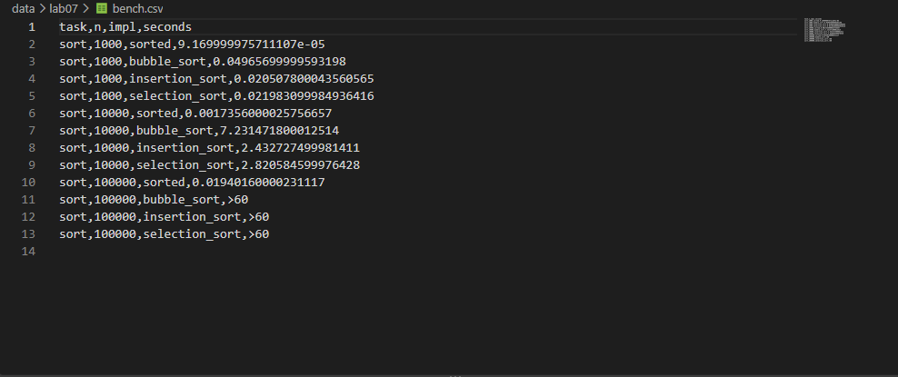

# Лабораторная работа 7

## Задание 1. Реализация алгоритмов поиска

В файле `search.py` реализованы алгоритмы линейного и бинарного поиска. Линейный поиск последовательно проверяет элементы списка, а бинарный поиск находит нужный элемент путём деления отсортированного списка пополам. Также реализованы две версии задачи Two Sum: полный перебор пар элементов и более эффективный поиск с использованием словаря

[Посмотреть код search.py](search.py)

## Задание 2. Реализация алгоритмов сортировки

В файле `sorting.py` реализованы три алгоритма сортировки: пузырьком, вставками и выбором. Каждый алгоритм создаёт новый список и возвращает его в отсортированном виде, не изменяя исходные данные

[Посмотреть код sorting.py](sorting.py)

## Задание 3. Проверка корректности алгоритмов

В файле `check.py` реализованы автоматические проверки всех алгоритмов. Результаты сортировок сравниваются со встроенной функцией `sorted()`, линейный поиск проверяется с помощью `list.index()`, а бинарный поиск тестируется на отсортированных списках. Дополнительно проверяется корректность обеих реализаций Two Sum

Для запуска проверок используется команда:

```bash
python -m src.lab07.check
```

[Посмотреть код check.py](check.py)



## Задание 4. Измерение производительности алгоритмов

В файле `bench.py` с помощью модуля `timeit` измеряется время выполнения алгоритмов сортировки, поиска и Two Sum

Для запуска измерений используется команда:

```bash
python -m src.lab07.bench
```

Результаты выводятся в консоль и сохраняются в CSV-файл.

[Посмотреть код bench.py](bench.py)



## Задание 5. Сохранение и анализ результатов

Результаты измерений сохраняются в файл `bench.csv`, расположенный в директории `data/lab07/`. Файл содержит название задачи, размер входных данных, использованную реализацию алгоритма и время выполнения в секундах

[Посмотреть результаты bench.csv](../../../../data/lab07/bench.csv)


