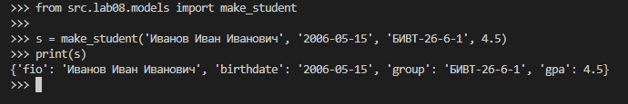
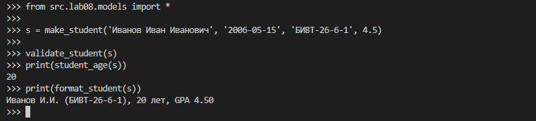
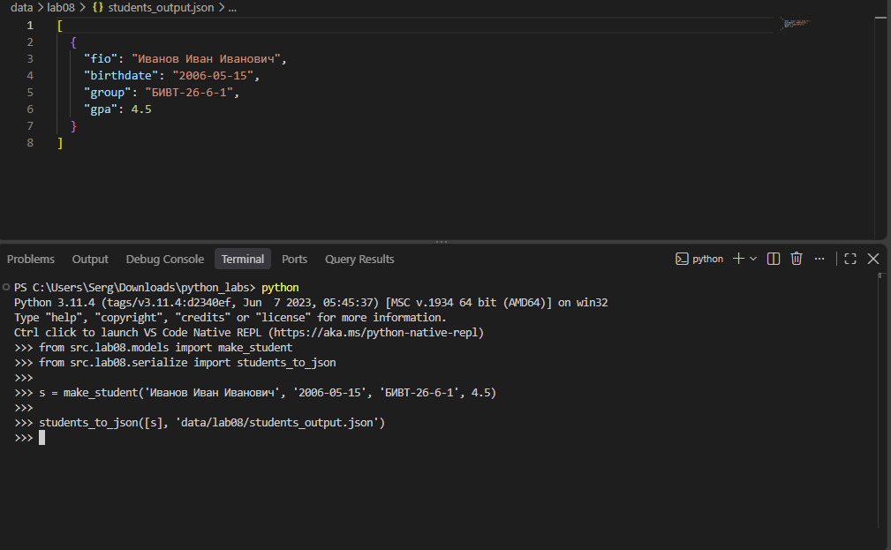
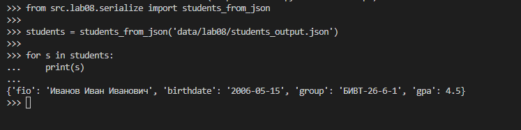

# Лабораторная работа 8

## Задание 1. Создание модели Student

В файле `models.py` реализована модель студента в виде словаря с фиксированным набором полей: `fio`, `birthdate`, `group` и `gpa`. Константа `STUDENT_FIELDS` хранит названия этих полей.

Функция `make_student()` создаёт запись и проверяет значения. Функция `validate_student()` проверяет набор ключей, ФИО, группу, дату рождения и средний балл. Для проверки даты используется `date.fromisoformat()`. Средний балл должен находиться в диапазоне от 0 до 5.

[Посмотреть код models.py](models.py)



## Задание 2. Функции для работы с записью

В `models.py` реализованы дополнительные функции:

- `student_age()` — вычисляет количество полных лет с учётом дня рождения;
- `format_student()` — формирует строку с фамилией, инициалами, группой, возрастом и GPA;
- `student_to_dict()` — возвращает копию записи;
- `student_from_dict()` — создаёт запись из словаря с проверкой данных;
- `update_student()` — возвращает новую запись с изменёнными полями, не затрагивая исходную.

[Посмотреть код models.py](models.py)



## Задание 3. Сериализация и десериализация JSON

В файле `serialize.py` реализованы функции `students_to_json()` и `students_from_json()`. Первая сохраняет список студентов в JSON в виде массива объектов. Вторая загружает массив и проверяет каждую запись с помощью `student_from_dict()`.

При сохранении используется `ensure_ascii=False` и `indent=2`, поэтому кириллица остаётся читаемой, а JSON имеет удобное форматирование.

Пример запуска:

```python
from src.lab08.serialize import students_to_json, students_from_json

students = students_from_json('data/lab08/students_input.json')
students_to_json(students, 'data/lab08/students_output.json')

result = students_from_json('data/lab08/students_output.json')
print(result)
```

[Посмотреть код serialize.py](serialize.py)



## Задание 4. Проверка некорректных данных

Для демонстрации проверки подготовлен файл `students_bad.json`, содержащий запись с некорректной датой и запись со средним баллом за пределами допустимого диапазона.

Выбрана политика `strict`: при обнаружении первой некорректной записи функция `students_from_json()` вызывает `ValueError`. В сообщении указывается номер записи и причина ошибки. Остальные записи после ошибочной не загружаются.

Пример запуска:

```python
from src.lab08.serialize import students_from_json

students_from_json('data/lab08/students_bad.json')
```

[Посмотреть код serialize.py](serialize.py)



## Задание 5. Дополнительная работа с CSV

Дополнительно реализована функция `students_from_csv()`, которая читает записи из CSV-файла с заголовками `fio,birthdate,group,gpa`.

При чтении CSV все значения изначально имеют строковый тип. Поэтому поле `gpa` преобразуется во `float` непосредственно в `students_from_csv()`, после чего запись проходит проверку через `student_from_dict()`.

## Вывод

В ходе лабораторной работы была реализована модель Student без использования классов — в виде словаря с фиксированными полями. Созданы функции-конструкторы, валидации, вычисления возраста и форматирования записи. Реализованы сериализация и десериализация JSON с проверкой входных данных. Дополнительно реализованы обновление записи без изменения исходного словаря и чтение данных из CSV.